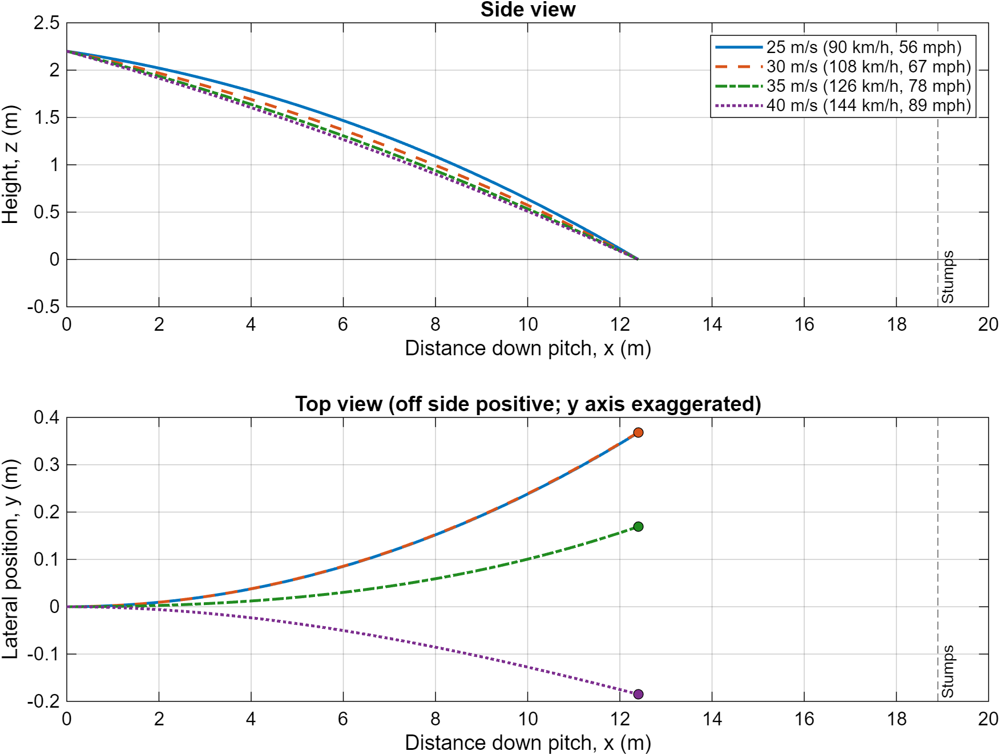
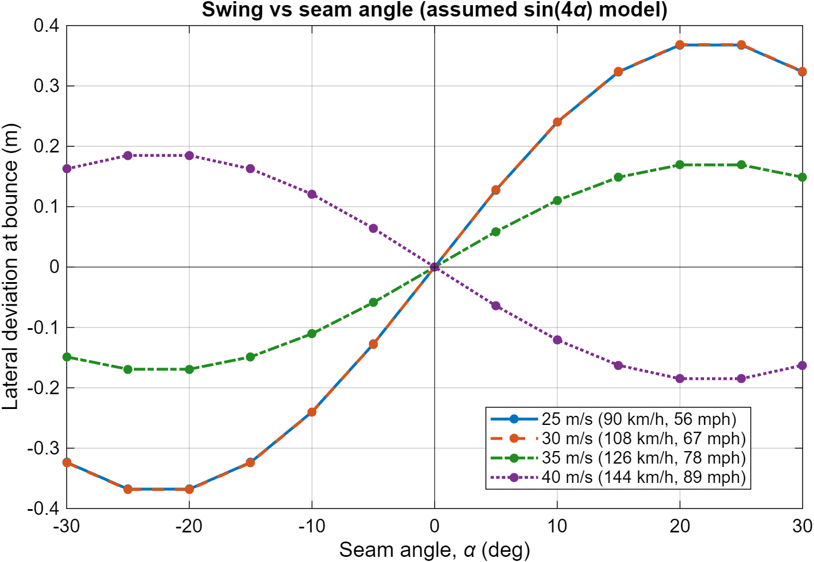
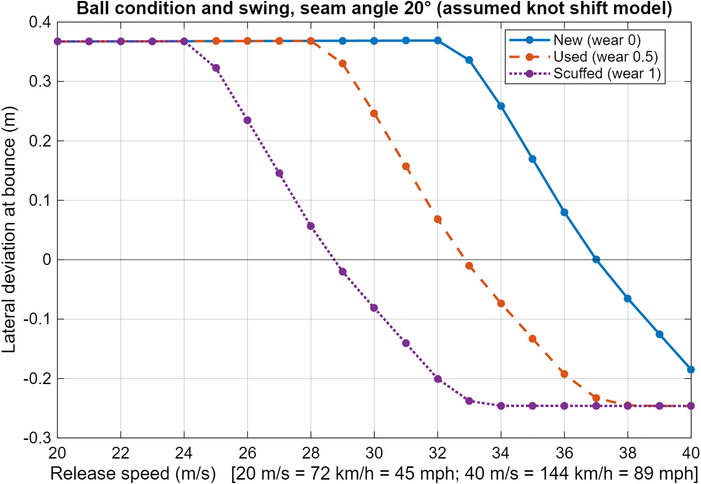

# Cricket Ball Flight Model (MATLAB)

A 3D simulation of a cricket ball from release to first bounce, with quadratic aerodynamic drag and a crude lateral "swing" force. Base MATLAB only (no toolboxes). Tested on R2025b.

## Quick start

1. Set this folder as the MATLAB Current Folder.
2. `sanity_check_vacuum`: checks the integrator against the analytical projectile solution (forces off).
3. `cricket_ball_flight`: main run. Side view, top view, summary table.
4. Optional studies: `seam_angle_sweep`, `ball_condition_sweep`.

## Figures

Release-to-bounce trajectories (side and top view). Lateral scale is exaggerated; deviation is at the bounce, not the stumps.

Lateral deviation vs seam angle (assumed sin(4 alpha) model):

Lateral deviation vs release speed for new, used and scuffed balls (assumed knot-shift model):

Vector PDF versions of all three are in the repo (`ball_flight.pdf`, `seam_sweep.pdf`, `ball_condition_sweep.pdf`), plus a 300 dpi PNG of the main figure (`ball_flight_300dpi.png`).

## Files

| File | Purpose |
|---|---|
| `cricket_ball_flight.m` | Main script: parameters, speed loop, plots, table |
| `ball_ode.m` | Equations of motion (right-hand side for `ode45`) |
| `ground_event.m` | Events function: stops integration at z = 0 |
| `simulate_flight.m` | Integrates one delivery for a given speed and release angle |
| `solve_release_angle.m` | Shooting method (`fzero`): finds the release angle that pitches the ball at a target distance |
| `build_CS_fun.m` | Builds C_S(v) for a given seam angle and ball wear |
| `seam_factor.m` | Seam-angle scaling of C_S |
| `sanity_check_vacuum.m` | Validation against the analytic solution and energy conservation |
| `seam_angle_sweep.m` | Deviation vs seam angle for each release speed |
| `ball_condition_sweep.m` | Deviation vs release speed for new/used/scuffed balls |

## Coordinates and set-up

- x down the pitch, y lateral (off side positive), z vertical (up). SI units throughout.
- Release at x = 0, y = 0, z = 2.2 m. Stumps at x = 18.9 m (reference line only).
- Release velocity: speed v0, directed down the pitch at an angle theta **below** the horizontal, no lateral component.
- Release speeds 25, 30, 35, 40 m/s (90, 108, 126, 144 km/h; 56, 67, 78, 89 mph).
- The simulation ends at the first bounce (z = 0). Results are **at the bounce, not at the stumps**.

## Equations of motion

State s = [x, y, z, vx, vy, vz]. With v = |velocity| and q = 0.5 ρ v² A:

- Drag: F_D = q C_D, directed opposite to the velocity (-v̂).
- Swing: F_S = q C_S(v), directed along n = (-vy, vx, 0)/|v_h|. This is perpendicular to the full velocity vector and lies in the horizontal plane, so it does no work. With vy = 0 and C_S > 0 it points to +y (off side).
- Gravity: F_g = (0, 0, -m g).
- Acceleration = (F_D + F_S + F_g) / m.

Integrated with `ode45`, RelTol 1e-8, AbsTol 1e-10. The ground event is terminal and triggers only when z is decreasing.

## Parameters and justification

| Quantity | Value | Basis |
|---|---|---|
| Mass m | 0.160 kg | Within the Laws of Cricket (Law 4) range, 155.9-163.0 g |
| Diameter d | 0.072 m | From the Laws' circumference range of 22.4-22.9 cm (71.3-72.9 mm) |
| Area A | pi (d/2)^2 = 4.07e-3 m^2 | Sphere approximation; the ~1 mm seam is not in the geometry |
| Air density rho | 1.225 kg/m^3 | ISA sea level, 15 C. Weather effects are about 2%, small compared with other assumptions |
| Drag coefficient C_D | 0.45, constant | Typical literature magnitude; see limitations |
| Gravity g | 9.81 m/s^2 | |

Reynolds number Re = rho v d / mu is about 1.2e5 at 25 m/s and 1.9e5 at 40 m/s (mu = 1.81e-5 Pa s). This is in the transition region where seam-induced asymmetry matters. A real cricket ball has a rough, scuffed surface, so its critical Re is below that of a smooth sphere.

## Swing model (the main assumptions)

Side-force coefficient: C_S(v, seam, wear) = seam_factor(seam) x C_S_speed(v - shift).

**Speed dependence (new ball, piecewise linear, clamped outside 25-40 m/s):**

| Speed (m/s) | C_S |
|---|---|
| 25-32 | +0.3 (conventional swing) |
| 32-36 | linear taper to 0 |
| 36-40 | linear to -0.2 (reverse swing) |

C_S is evaluated at the **instantaneous** speed inside the ODE, because drag slows the ball by about 3-4 m/s before the bounce. A ball released at 35 m/s crosses the taper region mid-flight.

**Seam angle (extension):** seam_factor = sin(4 alpha) / sin(4 x 20 deg), alpha clamped to +/-45 deg. It is 1 at the 20 deg calibration angle, 0 at 0 deg and 45 deg, and negative for negative alpha (swing direction reverses). This shape is an **assumption** chosen to match the qualitative behaviour, not a published fit.

**Ball condition (extension):** a wear parameter between 0 (new) and 1 (scuffed) shifts all speed knots down by wear x 8 m/s, so reverse swing begins at a lower speed. The direction of the effect matches the literature on old balls; the 8 m/s maximum shift is an **assumption**.

## Release angle

Each speed gets its own release angle, found with `fzero` so that every ball pitches at 12.4 m from release (6.5 m in front of the stumps, a good length), drag and swing included. This keeps length constant so only speed and swing change between curves.

## Validation

`sanity_check_vacuum` sets C_D = C_S = 0 and compares with the analytical projectile solution at a 6 deg release angle, 35 m/s. Observed: flight time and bounce x agree to about 1e-13, and relative drift in v^2/2 + g z is about 2e-16.

## Results (main run, seam 20 deg, new ball)

| v0 (m/s) | Release angle (deg) | Flight time (s) | Bounce x (m) | Lateral deviation (m) |
|---|---|---|---|---|
| 25 | 4.20 | 0.520 | 12.40 | 0.368 |
| 30 | 5.98 | 0.435 | 12.40 | 0.369 |
| 35 | 7.06 | 0.373 | 12.40 | 0.169 |
| 40 | 7.76 | 0.327 | 12.40 | -0.185 |

Notes on these results:

- 25 and 30 m/s give almost the same deviation. With constant C_S, lateral acceleration scales as v^2 and flight time as 1/v, so deviation is about 0.5 (q C_S / m)(x/v)^2, which does not depend on speed. In this model speed affects swing only through C_S(v) and the drag slowdown.
- The 40 m/s deviation is smaller than the C_S = -0.2 value would suggest because the ball slows to about 36.5 m/s, where C_S is near 0.
- The seam sweep shows swing peaking near 20-25 deg and vanishing at 0 deg, by construction of the sin(4 alpha) model.
- The ball-condition sweep shows the deviation crossing zero at about 37, 33 and 29 m/s for new, used and scuffed balls.

## Limitations

- C_D is constant. In reality C_D varies with Re and surface state near the transition (drag-crisis behaviour), and the swing regime itself depends on it.
- The C_S speed knots (32, 36, 40 m/s, +0.3, -0.2) are modelling choices, not measured data. Reverse swing at 40 m/s is only plausible for a worn ball.
- C_S is treated as a function of speed and seam angle only. There is no dependence on spin rate, seam wobble, surface roughness differences, or the ball's changing orientation in flight.
- No ball spin, so no Magnus force and no seam-position rotation.
- No wind and no pitch interaction beyond ending the simulation at z = 0.
- The seam-angle and ball-wear factors are assumed forms (see above).
- Deviation is reported at the bounce, 12.4 m from release, not at the stumps.

## References to check

These are the sources I used for ranges and qualitative behaviour. I have not verified exact figures (for example the 0.3 side-force coefficient or the seam angle at which it peaks), so read the originals before quoting them.

- MCC, Laws of Cricket, Law 4 (the ball): mass and circumference.
- R. D. Mehta (1985), "Aerodynamics of sports balls", Annual Review of Fluid Mechanics.
- A. T. Sayers and A. Hill (1999), "Aerodynamics of a cricket ball", Journal of Wind Engineering and Industrial Aerodynamics.
- A. T. Sayers (2001), "On the reverse swing of a cricket ball: modelling and measurements", Proc. IMechE.
- R. D. Mehta (2005), "Cricket ball aerodynamics: myth versus science".
